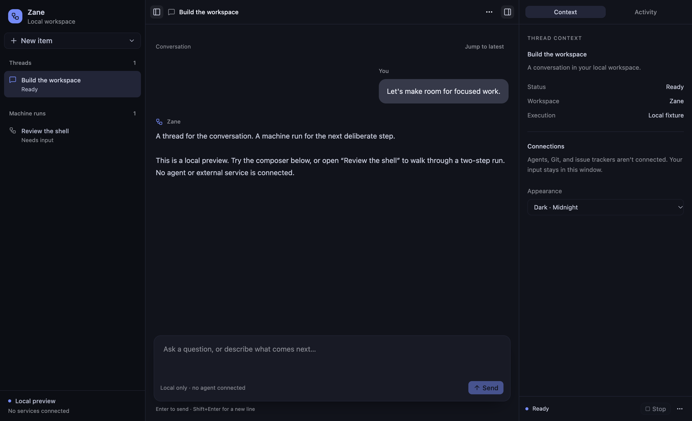
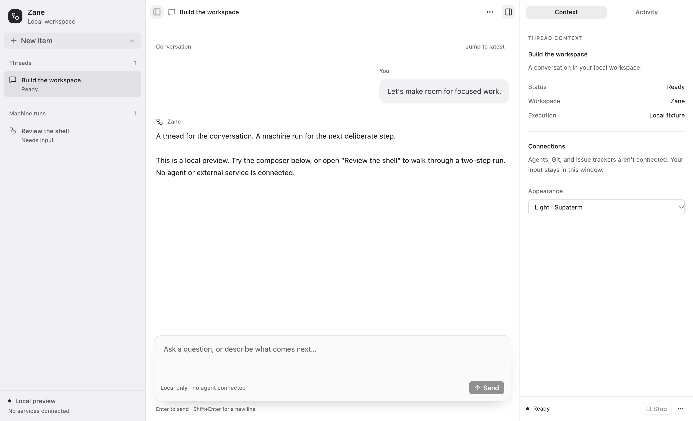
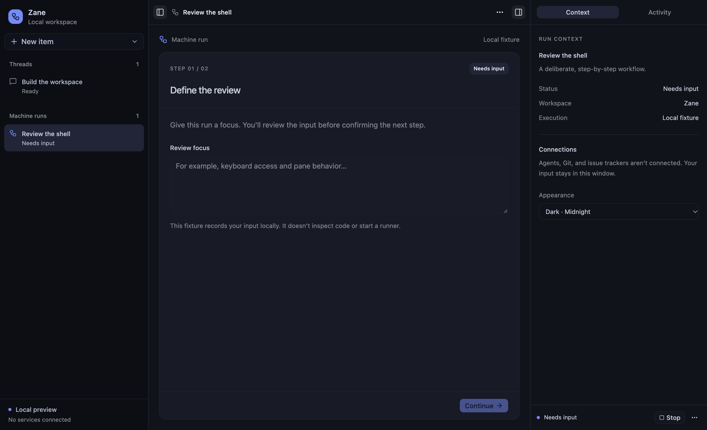
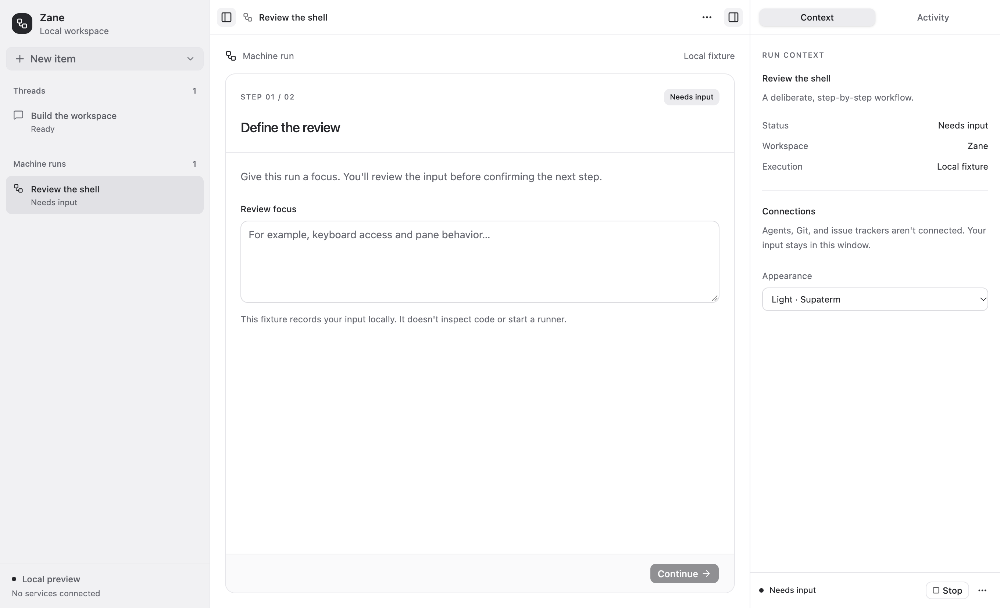

# Workspace shell implementation

The desktop route renders the local fixture in
`src/lib/components/workspace/workspace.svelte`. This is a UI integration boundary,
not an agent runtime. Thread/run content resets on reload; only appearance and pane
layout are persisted.

## Composition

| Component       | Responsibility                                                                                                                                                                    |
| --------------- | --------------------------------------------------------------------------------------------------------------------------------------------------------------------------------- |
| `AppShell`      | Resizable navigation, center, and inspector panes. Accepts navigation, header, center children, and inspector snippets. The header receives pane visibility and toggle callbacks. |
| `Navigation`    | Project context, distinct thread/run groups, selection, and creation callbacks.                                                                                                   |
| `ContentHeader` | Selected title, always-reachable pane toggles, and item action menu.                                                                                                              |
| `ThreadView`    | Independently scrolling plain-text messages and a fixed composer snippet.                                                                                                         |
| `Composer`      | Bindable multiline draft, trim/empty guard, submit and stop callbacks, disabled/busy presentation.                                                                                |
| `MachineStep`   | Current-step title, status, independently scrolling content snippet, and fixed action snippet. It does not render a transcript.                                                   |
| `Inspector`     | Context/activity snippets in keyboard-operable tabs, a footer snippet, and an optional lower `position` snippet for a future machine-position view. No graph is implemented.      |
| `StatusActions` | Compact status, stop callback, and reset dropdown.                                                                                                                                |

Future diff, ticket, and machine-position content can be supplied through these
snippets without modifying the shell. No provider stores, upstream React
components, or speculative plugin registry are introduced.

## State and interaction

`Workspace` owns each item's draft, activity, and thread messages or machine-step
phase. Switching items or inspector tabs does not discard drafts. Submitting a
thread message adds a user message and enters a local busy state until Stop is
invoked; it never fabricates an assistant response. Existing assistant content is
explicitly sample fixture content. Input and confirmation move a run through two
local steps. Back preserves input, Stop preserves the draft, Start again returns
to input, and Reset clears that item's content.

Composer Enter submits, Shift+Enter inserts a newline, and IME composition Enter
does not submit. Native textarea behavior handles multiline machine input;
Continue and Confirm are form submissions. Menus and tabs use Bits UI keyboard
handling. Pane dividers support arrow keys and pointer dragging; double-click
restores the default width.

## Pane persistence

The shadcn-svelte Resizable primitive delegates layout and persistence to
Paneforge. Default pane proportions are 21/54/25, with 18/35/18 minimum proportions
and collapsible side panes. Hidden pane content remains mounted but is hidden and
inert, so it cannot receive focus and does not reset tab state.

Paneforge persists the actual layout and visibility under
`paneforge:zane-workspace-v1`. The shell stores only the two remembered expanded
proportions under `zane-workspace-v1:expanded`: Paneforge 1.0.2 does not remember
pre-collapse widths when dragging shut. The shell snapshots widths at drag start,
tracks non-drag resizing, validates saved sizes, and reopens through `resize`.
Visibility is derived from the actual pane state; capture-phase Enter uses the
same toggle as the header rather than Paneforge's callback-free Enter handler.

A stable `layoutId` supplies both storage keys and pane IDs.
`persistLayout={false}` isolates ordinary stories. Remount stories verify widths
and visibility after header and pointer collapse. Electron opens at 1360×860, with
a 760×540 desktop minimum; titles and status labels truncate rather than expanding
their panes.

## Packaged renderer

Forge's Vite plugin clears `.vite` during packaging and uses the legacy single-build
API. SvelteKit 3 needs the application builder to emit its client, prerendered page,
and static assets. `electron/package-renderer.ts` invokes `createBuilder().buildApp()`
and copies the complete result into Forge's staging directory in `packageAfterCopy`.
The preload path uses Forge's actual `preload.cjs` output. A regression test builds
and verifies the staged entry page, appearance bootstrap, and route assets. Its
`.build-test.ts` suffix scopes it to the desktop Vitest configuration: SvelteKit's
build workers require the desktop working directory, not the root's generic unit
runner.

The production `file://` renderer was also exercised in Electron: both themes,
thread submit/stop, machine confirmation, pointer resizing, collapsed-pane reload
and width restoration, and a 760×540 content viewport without page-level overflow.
The packaged ASAR was checked for the main, preload, renderer, and bootstrap files.

## Verification

From `apps/desktop`:

```sh
vp exec svelte-check --tsconfig ./tsconfig.json
vp test --run
vp build
vp run storybook:build
```

The `Workspace` Storybook group covers each reusable component and the assembled
shell in Midnight and Supaterm light, including selected, empty, disabled, and busy
states. Interaction stories cover selection/creation, multiline and IME input,
submit/stop, machine input/back/confirmation/restart, keyboard menus and tabs,
independent transcript scrolling, divider Enter, pointer collapse, panel controls,
and restart persistence.
Accessibility violations fail the new stories rather than being marked as TODO.

## Visual evidence

Captured from the production `file://` renderer in Electron, not a separate mockup.









## Reference and attribution

Visual and behavioral reference:
[`supabitapp/supaterm@5a05f44ec3f960716139f9723ceab6995b3c0b50`](https://github.com/supabitapp/supaterm/tree/5a05f44ec3f960716139f9723ceab6995b3c0b50).
The shell uses the shared palette described in [design-tokens.md](design-tokens.md).
